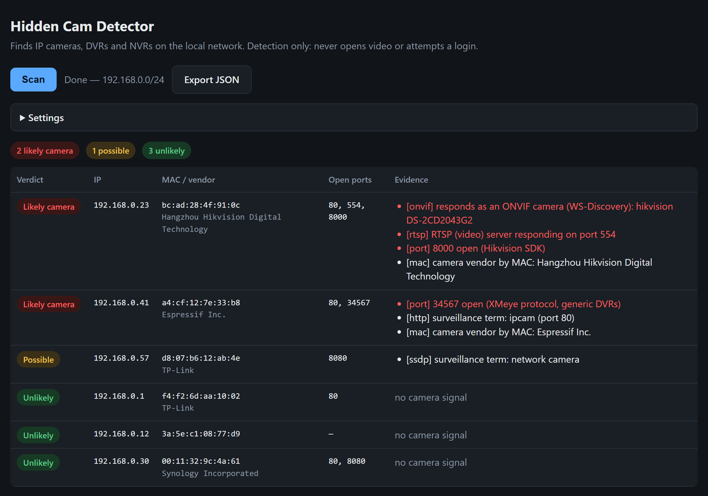

# Detector Camere Ascunse / Hidden Cam Detector

Scanează rețeaua locală după camere IP, DVR-uri și NVR-uri (ex. într-un Airbnb sau hotel) și arată rezultatele într-o interfață web locală.

**Doar detecție.** Nu deschide flux video, nu capturează imagini și nu încearcă autentificări sau parole.

Interfața este **bilingvă (RO / EN)** — comutatorul de limbă e în colțul din dreapta sus.



<sub>Screenshot with demo data.</sub>

---

## Utilizare / Usage

### Opțiunea 1: binar precompilat (cel mai simplu)

1. Descarcă fișierul pentru sistemul tău din pagina **Releases** de pe GitHub:
   - Windows: `hidden-cam-detector-windows-amd64.exe`
   - macOS Apple Silicon: `hidden-cam-detector-darwin-arm64`; macOS Intel: `hidden-cam-detector-darwin-amd64`
   - Linux: `hidden-cam-detector-linux-amd64` sau `-linux-arm64` (Raspberry Pi)
2. Rulează-l. Browserul se deschide automat la `http://127.0.0.1:8765`.
   - macOS/Linux: `chmod +x hidden-cam-detector-*` înainte. Pe macOS, dacă Gatekeeper blochează: `xattr -d com.apple.quarantine hidden-cam-detector-darwin-*`.
3. Apasă **Scanare** / **Scan**.

### Opțiunea 2: din sursă

Necesită Go 1.23+.

```sh
go run .
```

Sau construiește binarul cu `go build`.

### Opțiuni / Options

| Flag | Implicit | Descriere |
|---|---|---|
| `--listen` | `127.0.0.1:8765` | Adresa UI. `0.0.0.0:8765` permite accesul de pe telefon, dar expune panoul în toată rețeaua. |
| `--no-browser` | `false` | Nu deschide browserul. |

Subrețeaua, porturile suplimentare și timeout-ul se setează în UI. Subrețeaua e detectată automat (plafon /24).

---

## Cum detectează / How it detects

| Semnal | Greutate |
|---|---|
| Răspunde la ONVIF (WS-Discovery) | strong |
| Server RTSP care răspunde (554; și 8554 / 10554 ca porturi extra) | strong |
| Port 37777 (Dahua), 34567 (XMeye) sau 8000 (Hikvision) deschis | strong |
| Marcă de cameră în banner HTTP, SSDP/UPnP sau RTSP | strong |
| Serviciu video anunțat via mDNS (`_rtsp._tcp`, `_axis-video._tcp`) | strong |
| Producător de camere după MAC | weak |
| Port 8899 (ONVIF) sau 1935 (RTMP) deschis | weak |
| Termen generic (DVR, NVR, CCTV…) în banner | weak |

Orice semnal strong = **cameră probabilă** / **likely camera**; doar weak = **posibil** / **possible**; niciunul = **puțin probabil** / **unlikely**. Greutățile și etichetele sunt în `policy.go`; traducerile UI în `web/index.html`.

Fără drepturi de admin, Npcap sau nmap: folosește conexiuni TCP, UDP multicast și tabelul ARP al sistemului.

### Limitări / Limitations

- Camerele doar pe card SD, fără Wi-Fi, sau pe altă rețea (Wi-Fi separat al gazdei, 4G) nu apar.
- Rețelele de hotel cu izolare între clienți ascund celelalte dispozitive.
- Telefoanele/laptopurile moderne folosesc MAC-uri aleatoare; apar fără producător.

## Listă producători / Vendor list

Fiecare MAC vine din `oui.txt` (~40k prefixe), generat din [lista Wireshark](https://www.wireshark.org/download/automated/data/manuf). Embedded în binar, funcționează offline:

```sh
go generate ./...
```

## API

| Method | Route | Description |
|---|---|---|
| `GET` | `/api/config` | Subnet detectat, porturi implicite, timeout |
| `POST` | `/api/scan` | Pornește scanarea. Body: `{"subnet":"192.168.0.0/24","extraPorts":[9000],"timeoutMs":700}`. `409` dacă rulează deja |
| `GET` | `/api/devices` | Starea curentă (același JSON ca Export) |
| `GET` | `/api/events` | Server-Sent Events: eveniment `state` la fiecare schimbare (max. la 250 ms) |

## Release

```sh
git tag v0.1.0 && git push --tags
```

## Folosire responsabilă / Responsible use

Folosește-l pentru confidențialitate unde stai, sau pe rețele pe care le administrezi. Instrumentul doar identifică dispozitive; nu accesează video și nu încearcă parole.

Bazat pe [develogo/hidden-cam-detector](https://github.com/develogo/hidden-cam-detector), adaptat cu interfață RO/EN.
